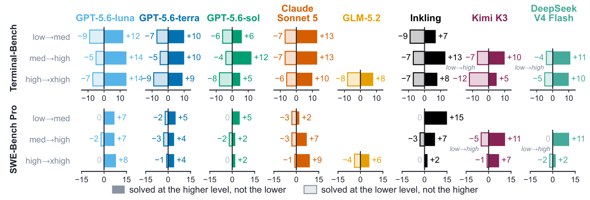
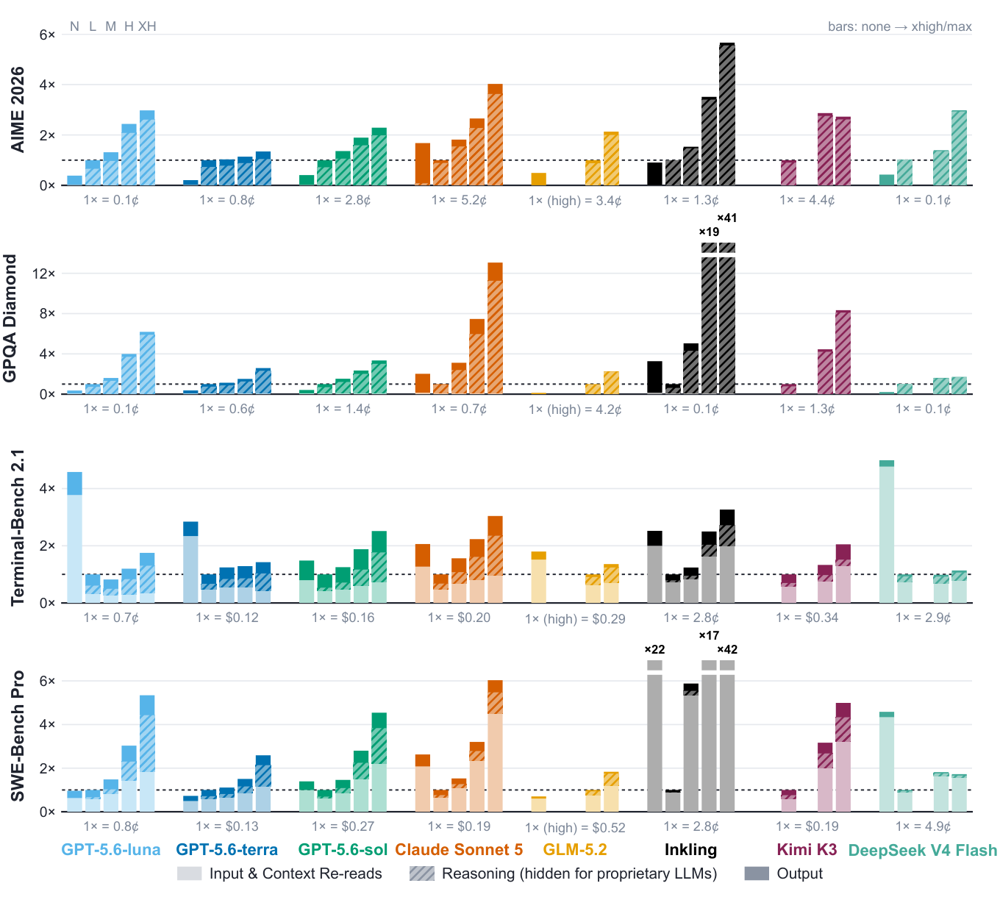
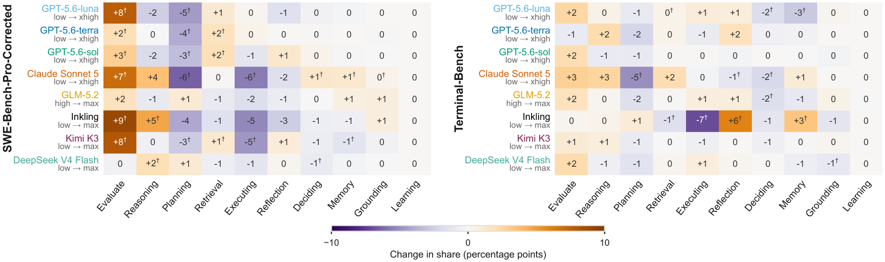

<div align="center">

# What Effort Level Should I Choose?

### On the Economics of Reasoning Effort in LLM Agents

[](https://arxiv.org/abs/2610.34491)
[](requirements.txt)
[](LICENSE)
[](#citation)

**Kaiser Sun**<sup>1\*†</sup>, **Yongchan Kwon**<sup>2</sup>, **Zain Hasan**<sup>2</sup>,
**Shang Zhu**<sup>2</sup>, **Kaitlyn Zhou**<sup>3,2</sup>, **Federico Bianchi**<sup>2†</sup>

<sup>1</sup>Johns Hopkins University · <sup>2</sup>Together AI · <sup>3</sup>Cornell University

<sub>\*Work done during an internship at Together AI. †Corresponding authors.</sub>



<sub>Tasks gained (solid) and lost (hollow) when a model moves up one reasoning-effort level.</sub>

</div>

Many LLMs expose a **reasoning effort** setting that buys more inference-time compute. Users
must pick a level before knowing whether the extra reasoning will help, and a successful run
does not show whether the effort was needed: reasoning effort is a **credence good**. We
measure the counterfactual effect of every effort level for eight proprietary and open-weight
models on four benchmarks, from single-call reasoning to long-horizon agentic tasks.

- **Higher effort is not a superset of lower effort.** It can raise aggregate accuracy, yet it
  frequently fails tasks that a lower level solved (figure above).
- **Higher effort overspends on easy tasks.** On tasks every level solves, the highest level
  costs up to **42×** as much as the lowest.
- **Effort changes how agents work.** At higher effort, agents verify their own work more and
  more often search for solutions instead of working through the problem, which lengthens
  trajectories without necessarily changing the outcome.
- **Escalate on failure instead.** Starting at the lowest level and escalating only after a
  verified failure matches or improves on fixed top effort across all models and benchmarks,
  at lower cost for most proprietary models.

<details>
<summary>Cost on always-solved tasks and behavior shifts</summary>





</details>

## About this repository

Code for running the experiments and rebuilding the figures and tables of the paper.

The study holds the task set, the prompt and the agent harness fixed, varies a model's
reasoning-effort setting, and records task outcomes, token usage and cost at every level. It
covers eight models on four benchmarks:

| Benchmark | Units | Harness | Attempts |
|---|---|---|---|
| AIME 2026 | 30 problems | one API call per attempt | 10 per problem |
| GPQA Diamond | 198 questions | one API call per attempt | 4 per question |
| Terminal-Bench 2.1 | 89 tasks | harbor + Terminus-2 | 1 per task |
| SWE-Bench Pro (original and corrected) | 44-instance subset | mini-swe-agent | 1 per instance |

Models: GPT-5.6-sol, GPT-5.6-terra, GPT-5.6-luna (OpenAI), Claude Sonnet 5 (Anthropic), and
GLM-5.2, Inkling, Kimi K3, DeepSeek V4 Flash (Together AI). Their effort levels are defined
in [`common/models.py`](common/models.py), per-token prices in
[`common/pricing.py`](common/pricing.py).

## Repository layout

```
common/          model registry, effort levels, price table, waiting-cost model, data paths,
                 container environments for the corrected SWE-Bench Pro setting
aime_2026/       AIME 2026: run_eval.py (generate + grade), report.py
gpqa_diamond/    GPQA Diamond: run_eval.py, report.py
terminal_bench/  Terminal-Bench 2.1: run_sweep.py (harbor), collect_cost.py
swebench_pro/    SWE-Bench Pro: prepare_dataset.py, run_sweep.py, evaluate.py, report.py,
                 verify_sanitization.py / verify_egress.py (checks of the corrected environment)
routing/         oracle router, self-routing (run_selection.py, make_self_routing.py),
                 naive laddering (make_laddering.py)
behavior/
  actonomy/      Act-onomy annotation of trajectories (extract, annotate, validate) and the
                 behavior-overview figure
  leakage/       detection of reference-fix retrieval in SWE-Bench Pro trajectories
figures/         every paper figure and table (make_*.py, create_*.py, deepswe/)
make_paper_artifacts.sh   rebuild all figures and tables from runs on disk
```

## Setup

Python 3.10.

```bash
python -m venv .venv && source .venv/bin/activate
pip install -r requirements.txt
cp .env.example .env        # then fill in the API keys you need
```

Additional requirements:

- **Docker**, for SWE-Bench Pro (agent containers and the official evaluator), Terminal-Bench
  (task containers), and the Act-onomy annotator.
- **harbor** for Terminal-Bench, installed as a uv tool: `uv tool install harbor==0.20.0`.
- API keys: `OPENAI_API_KEY`, `ANTHROPIC_API_KEY`, `TOGETHER_API_KEY`. The annotator uses
  Claude Code, authenticated with `CLAUDE_CODE_OAUTH_TOKEN` (from `claude setup-token`) or
  `ANTHROPIC_API_KEY`.

All commands below are run from the repository root. Results are written to `data/` and
derived products to `output/`. Set `REL_DATA_DIR` or `REL_OUTPUT_DIR` to use other locations.

## Running the experiments

Running every experiment calls paid APIs. At the paper's settings, benchmark inference alone
costs roughly $7,500 in total, and the Act-onomy annotation costs about $3,900. Every run
script has `--dry-run` (or `--limit N`); use them to check a configuration before a full run.
All runs resume from what is already on disk.

**AIME 2026 and GPQA Diamond.** The defaults run every effort level the model supports, with
10 (AIME) or 4 (GPQA) attempts per item and a 128k-token output limit.

```bash
python aime_2026/run_eval.py --model gpt-5.6-sol --full
python gpqa_diamond/run_eval.py --model gpt-5.6-sol --full
python aime_2026/report.py --model gpt-5.6-sol
python gpqa_diamond/report.py --model gpt-5.6-sol
```

**Terminal-Bench 2.1.** One trial per task. The agent timeout is scaled for the Together-hosted
models (see `AGENT_TIMEOUT_MULTIPLIER` in `terminal_bench/run_sweep.py`).

```bash
python terminal_bench/run_sweep.py --model gpt-5.6-sol --full --workers 6
python terminal_bench/collect_cost.py --all
```

**SWE-Bench Pro.** The 44 instances in `swebench_pro/subsets/pilot.txt` are four evenly
spaced instances from each of the benchmark's 11 repositories. `--dataset pro` is the
official environment. `--dataset pro-corrected` removes the repository's git history and
restricts network access to package registries. Inkling, Kimi K3 and DeepSeek V4 Flash use
mini-swe-agent's native tool calling; all other models use the text-based scaffold. The
script picks the scaffold from the model.

```bash
python swebench_pro/prepare_dataset.py                       # once
python swebench_pro/run_sweep.py --model gpt-5.6-sol --workers 8
python swebench_pro/evaluate.py --model gpt-5.6-sol --run-eval --workers 16
python swebench_pro/report.py --dataset pro

python swebench_pro/verify_sanitization.py && python swebench_pro/verify_egress.py
python swebench_pro/run_sweep.py --model gpt-5.6-sol --dataset pro-corrected --workers 8
python swebench_pro/evaluate.py --model gpt-5.6-sol --dataset pro-corrected --run-eval
python swebench_pro/report.py --dataset pro-corrected
```

**Self-routing.** Each model is shown the task and asked which effort level to use; one
selection call per (model, task). The answers are scored against the runs above.

```bash
python routing/run_selection.py --dataset terminal_bench --all
```

Naive laddering and the oracle router need no new calls: they are computed from the runs.

**Behavior annotation (Act-onomy).** 30 Terminal-Bench tasks and 30 corrected SWE-Bench Pro
instances are annotated by Claude Sonnet 5 with the Act-onomy skill (vendored in
`behavior/actonomy/skill/`, see its `UPSTREAM.md`), using the task prompt in
`behavior/actonomy/PROMPT.md`. Each trajectory is annotated in a fresh container.

```bash
python behavior/actonomy/extract.py --benchmark tb --sample 30
python behavior/actonomy/extract.py --benchmark pro-corrected --sample 30
docker build -t actonomy-annotator:pinned behavior/actonomy
python behavior/actonomy/run_batch.py --benchmark tb --concurrency 3
python behavior/actonomy/run_batch.py --benchmark pro-corrected --concurrency 3
python behavior/actonomy/validate.py --benchmark tb
python behavior/actonomy/validate.py --benchmark pro-corrected
```

**DeepSWE (appendix).** The repeated-runs ablation uses the public DeepSWE v1.1 leaderboard
rollouts rather than new runs:

```bash
python figures/deepswe/snapshot_deepswe_trials.py                 # verdicts (trials.json)
python figures/deepswe/snapshot_deepswe_tokens.py TRAJECTORY_DIR  # token counts (~9 GB of trajectories)
```

The leaderboard may have changed since the paper's snapshot.

## Rebuilding the figures and tables

Once the runs are on disk:

```bash
./make_paper_artifacts.sh      # or: PYTHON=/path/to/python ./make_paper_artifacts.sh
```

This makes no API calls. It writes figures to `output/figures/` and LaTeX tables to
`output/tables/`.

| Paper artifact | Script |
|---|---|
| Instances gained and lost (main and appendix) | `figures/make_instances_gained.py` |
| Cost on always-solved tasks, API and full cost | `figures/make_solvable_cost.py --both` |
| Same, corrected SWE-Bench Pro | `figures/make_solvable_cost.py --corrected` |
| Same, DeepSWE | `figures/make_solvable_cost.py --both --deepswe` |
| Equal-accuracy effort pair and laddering, full cost | `figures/make_effort_pair_cost.py` |
| Self-routing and laddering (main, appendix, full cost) | `figures/make_effort_allocation.py` |
| Reference-fix retrieval and corrected solve rates | `figures/create_swebenchpro_reference_panels.py` |
| SWE-Bench Pro example trajectory | `figures/create_swebenchpro_example.py` |
| Behavior overview | `behavior/actonomy/make_behavior_overview.py` |
| DeepSWE instances gained and lost | `figures/deepswe/make_app_deepswe_instances_gained.py` |
| Accuracy table; original vs. corrected SWE-Bench Pro table | `figures/make_accuracy_tables.py` |
| DeepSWE retry table | `figures/deepswe/make_deepswe_retry_ablation.py` |

The routing tables (`routing/make_self_routing.py`, `routing/make_laddering.py`) and the
trajectory features (`behavior/leakage/extract_traj_features.py`,
`behavior/leakage/net_fetch_intent.py`) are intermediate stages; the shell script runs them
first.

The two reference-fix panels use the Inter typeface if `figures/fonts/Inter-*.ttf` is present
([rsms/inter](https://github.com/rsms/inter), SIL Open Font License); otherwise they fall back
to the default figure font.

## Citation

If you use this code or our findings, please cite the paper. The entry is also in
[`CITATION.bib`](CITATION.bib).

```bibtex
@article{sun2026effort,
  title   = {What Effort Level Should I Choose? On the Economics of Reasoning Effort in LLM Agents},
  author  = {Sun, Kaiser and Kwon, Yongchan and Hasan, Zain and Zhu, Shang and Zhou, Kaitlyn and Bianchi, Federico},
  journal = {arXiv preprint arXiv:2610.34491},
  year    = {2026},
  url     = {https://arxiv.org/abs/2610.34491}
}
```

## License

MIT; see [LICENSE](LICENSE). The vendored Act-onomy skill in `behavior/actonomy/skill/` keeps
its own licences (MIT code, CC BY 4.0 codebook); see its `UPSTREAM.md`.

## Cost accounting

Runs store token counts; dollars are always computed from the tokens and the rate table in
`common/pricing.py`. Changing a price therefore means re-running the report scripts, not the
experiments. Waiting cost (the "full cost" figures) uses each model's output throughput and an
hourly wage, both in `common/latency.py`.
